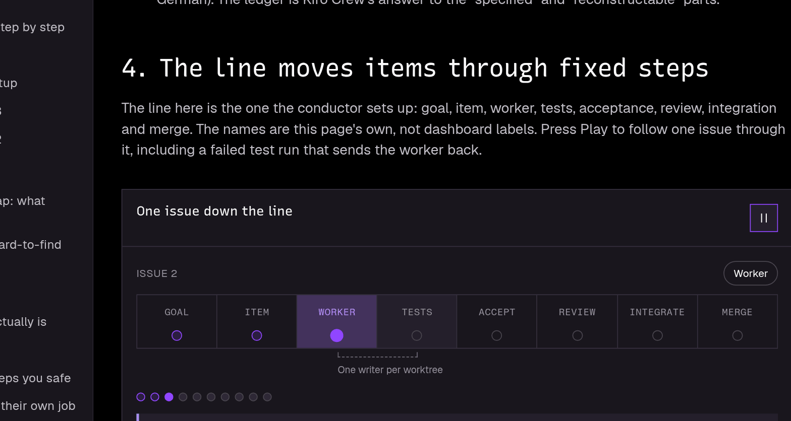
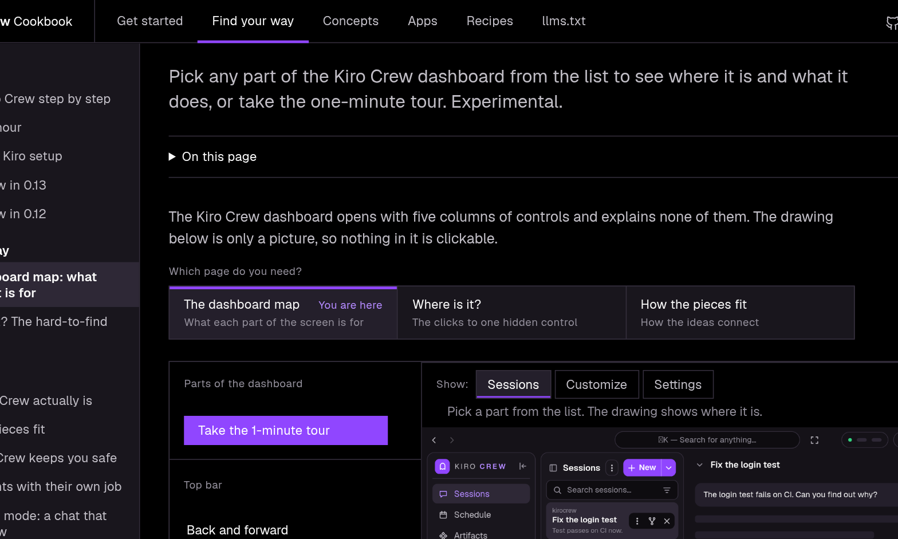
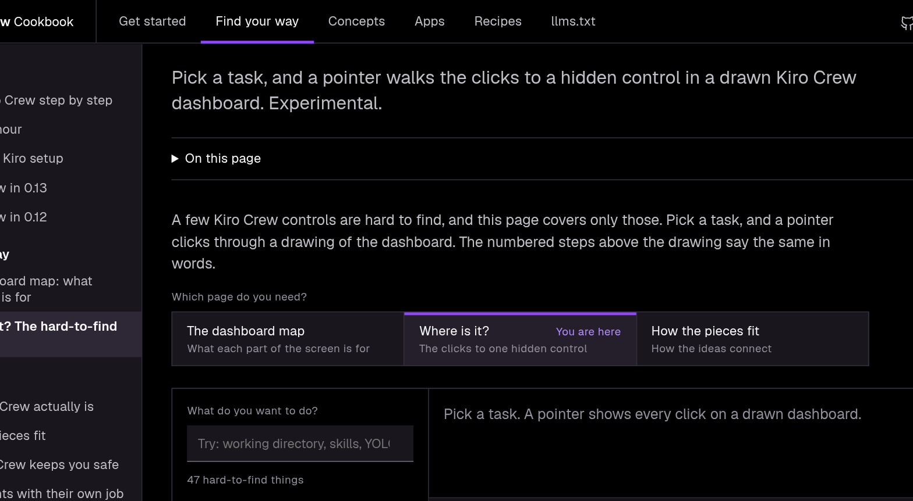
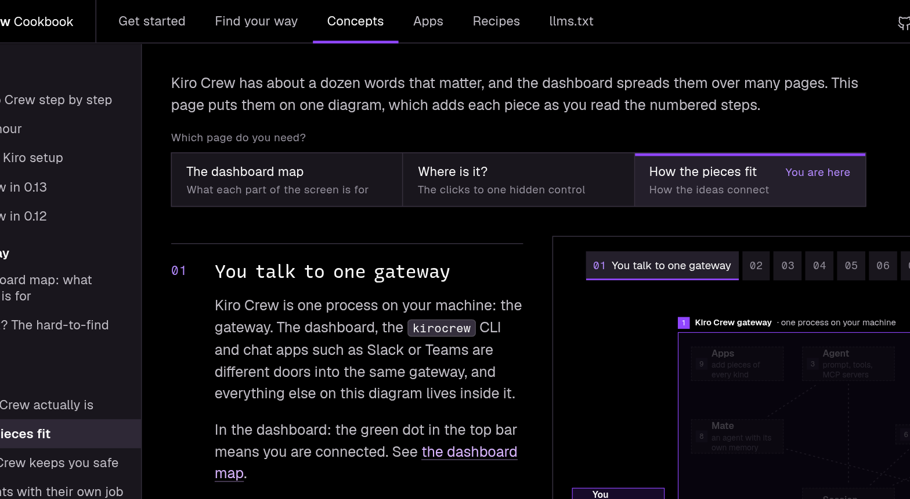

# Kiro Crew Cookbook

Recipes from real work with Kiro Crew. Checked against the Kiro Crew source, not written from memory.

## Interactive widgets

The cookbook includes interactive widgets that make navigation and learning easier:

### Software Factory


Watch how an issue flows through the agent pipeline — from triage to code to pull request.

### Dashboard Map


Click any part of the dashboard to learn what it does.

### Where Is It?


Search for hard-to-find controls by what they do.

### Architecture


See how the pieces connect — gateway, bots, memory, tools.

## Quick start

```bash
# Clone
git clone https://github.com/requix/kirocrew-cookbook.git
cd kirocrew-cookbook

# Install dependencies
pip install pygments pyyaml markdown-it-py

# Build
cd cookbook-site/preview
python3 build.py

# Preview locally
python3 -m http.server 8000 --bind 127.0.0.1 --directory dist
# Open http://localhost:8000
```

## Project structure

```
cookbook/                 # Markdown content (edit this)
├── index.md             # Landing page
├── meta.json            # Section order
├── start/               # Getting started guides
├── find/                # Navigation helpers
├── concepts/            # Core concepts
├── apps/                # Apps documentation
└── recipes/             # How-to recipes

cookbook-site/
├── preview/             # Python static site generator
│   ├── build.py         # Build script
│   ├── dist/            # Generated site (gitignored)
│   └── assets/          # Site CSS/JS
└── data/                # Shared data files
```

## Adding a recipe

1. Copy `cookbook/recipes/_template.md`
2. Fill in the frontmatter and content
3. Add the filename (without `.md`) to `cookbook/recipes/meta.json`
4. Run `python3 build.py` — it validates your content
5. Open a PR

See [CONTRIBUTING.md](CONTRIBUTING.md) for details.

## License

Content is licensed under [CC BY 4.0](LICENSE).
